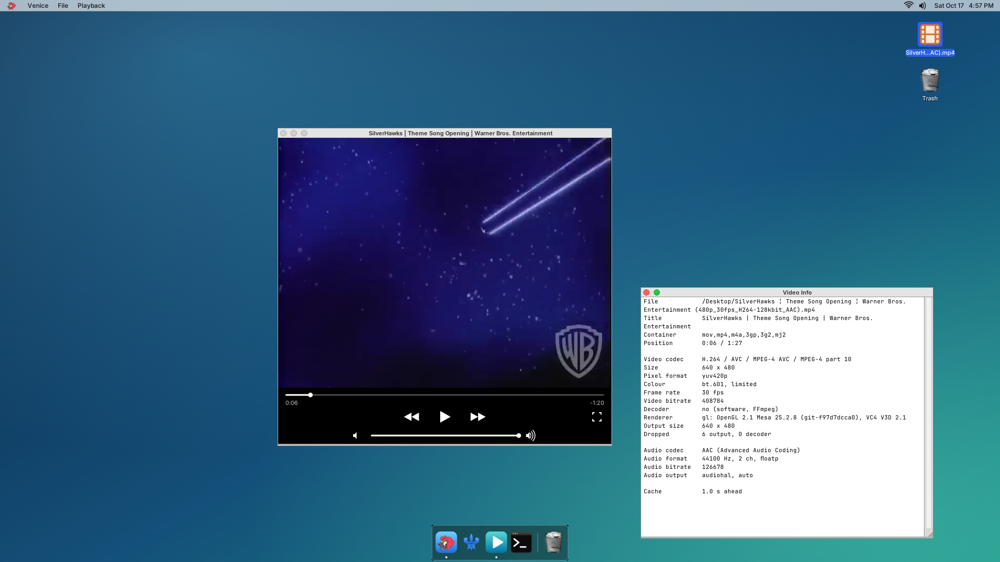

# Venice

**A small video player for GNUstep, on libmpv.** Venice plays local files and network streams on the GNUstep + Window Maker desktop of the Raspberry Pi 3 port of Darwin (the sibling repository [iokit](https://github.com/anurodhp/xnu-iokit-pi3)), next to [Milan](https://github.com/anurodhp/milan), [Naples](https://github.com/anurodhp/naples) and [Rome](https://github.com/anurodhp/rome). Playback is [mpv](https://mpv.io)'s, through libmpv's render API; Venice adds the window, the controls and the drawing surface.



*Venice on a Raspberry Pi 3 (1920x1080 desktop, Naples' menu bar and Milan's dock), with Video Info open: H.264 decoded by FFmpeg in software, drawn with OpenGL 2.1 on the VideoCore IV (Mesa vc4), sound through audiod.*

## Status

As of October 17, 2026, on the Pi 3 image:

- **Works:** local files and network streams (http, https, HLS), the iOS-style controls, Video Info, full screen, sound through `audiod` (the 3.5 mm jack), GL drawing on the Pi's GPU.
- **Works:** hardware decoding of H.264 and MPEG-4 Part 2 on the VideoCore VPU (see How it works). On the 720p test clip it takes the decoding off the ARM cores (6.2 s of CPU instead of 16.9 s for a 12-second clip), but drawing is still the limit at 1280x720, so 720p drops about as many frames as before.
- **Known bug:** with hardware decoding the last 20-odd frames of a file are not shown (the VPU signals end of stream early).
- **Limited (software decoding):** 480p plays smoothly and 720p does not (see the table below).
- **Not yet confirmed on the Pi:** full screen under Window Maker.
- **Known bug:** a second copy of Venice hangs at the start of playback while another copy has its audio open. Quit the other copy first, or start the second one with `-VeniceMPVOptions ao=null` for no sound.

## What you can do

- Open a file (File > Open, ⌘O), a URL (File > Open URL, ⌘U), a path or URL given on the command line (`Venice movie.mkv`), a file dropped on the video, or Open With from Milan (Venice declares video and audio types).
- Network streams: `http://`, `https://` (mbedTLS), HLS (`.m3u8`), RTMP, UDP/RTP multicast, and anything else FFmpeg's protocols and demuxers take.
- Controls on a black strip under the video, laid out like the iOS player: the **scrubber** across the whole window (it seeks to keyframes while you drag and exactly where you let go) with the elapsed time under its left end and the time left under its right ("LIVE" for a stream without a duration); **back 10 s, play/pause, forward 10 s** in the middle; and the **volume** between Naples' two speakers (the quiet one turns it down, the loud one up, or drag the track; the quiet one shows Naples' cross when muted). They are drawn by Venice as vector shapes, not theme art or font glyphs. Overlaying them on the video would need compositing on top of the GL surface, so they sit below it.
- Keys in the video: space plays and pauses, ← → seek 5 s (30 s with Shift), ↑ ↓ change the volume by 5, `m` mutes. A click on the video plays or pauses. The Playback menu has the same actions.
- The window fits itself to each new video, scaled down to the screen.
- Subtitles embedded in the file (libass).
- **Video Info** (Playback > Video Info, ⌘I): file, container, codecs, size, pixel format, colour, frame rate, bitrates, decoder, renderer, dropped frames, audio output and cache, refreshed every second.
- **Full screen** (the button at the right of the strip, Playback > Enter/Leave Full Screen, ⌘F, `f`, or a double-click on the video): the window asks Window Maker for `_NET_WM_STATE_FULLSCREEN` and hides the controls; Esc leaves.
- Sound through iokit's `audiod`, which starts at boot. On the Pi it plays on the 3.5 mm jack. audiod fades the sound out when playback pauses or ends, so there is no pop.

## How fast, on a Raspberry Pi 3

Big Buck Bunny, 720p H.264 High at 30 fps and 8 Mb/s, one pass (300 frames), on a Pi 3 B at 1.2 GHz with a 1920x1080 desktop, GL renderer, no audio (`ao=null`). Two runs each, measured on October 17, 2026:

| Window | Frames dropped | Drawn per frame |
|---|---|---|
| 854x480 | 16–63 (5–21%) | 25–27 ms |
| 1280x720 | 148–154 (about 50%) | 38 ms |

A frame at 30 fps has 33 ms. At 1280x720 the draw alone takes longer, so about every other frame is dropped. A 480p source (the SilverHawks clip in the screenshot, 640x480) plays with a handful of drops. Earlier numbers in this README were lower because they were measured while the kernel ran its clock 1.25x slow (no `timebase-frequency` for the Pi's 19.2 MHz timer), which gave every frame 25% more real time.

Four things on the system decide this, and an image needs all four (iokit has them):

- **The ARM clock.** The firmware keeps the cores at 600 MHz unless asked for more, and nothing in the port asks, so `config.txt` sets `force_turbo=1` (1.2 GHz). At 600 MHz FFmpeg decodes this clip at about 30 frames/s on four cores, no headroom at all, and two thirds of the frames were dropped; at 1.2 GHz it decodes at about 60.
- **MIT-SHM.** If `xlib_vc4` reports "MIT-SHM not used: shmget failed", `/etc/sysctl.conf` was not applied (no `/usr/sbin/sysctl`) and every frame goes through the X socket (41 ms instead of 3.6 to put an 854x480 frame).
- **The GPU read-back.** Each GL frame is read back from GPU memory by the CPU; the V3D driver now does that through a really cached mapping (4.1 ms for 1280x720 instead of 37.7).
- **The GPU memory pool.** The VideoCore's 3D block has no MMU, so its buffers must be physically contiguous. After a while of use, memory was too fragmented for large ones: allocation failed every frame, GL apps slowed to about 14 fps, and full-screen-sized windows stayed black. The V3D driver now reserves 128 MB at boot and allocates from that (`v3d-pool=<MB>` boot argument).

These numbers are with FFmpeg's software decoder (NEON, four threads), measured before Venice decoded on the VPU; the GPU does colour conversion, scaling and subtitles. With the VPU decoding (October 17, 2026, a 720p testsrc2 clip, `ao=null`), the whole run takes 6.2 s of CPU time instead of 16.9 s in a 1280x720 window and 6.5 s instead of 14.6 s at 854x480, but the draw stays at 34 ms/frame at 1280x720: at that size the drawing, not the decoding, is the limit. A window opens at most 1280 wide for a video (`VeniceMaxVideoWidth`). The sw renderer is 3-5x slower than gl at every size, which is why gl is the default.

## What you cannot do (yet)

- Hardware decoding covers only H.264 and MPEG-4 Part 2, the codecs the Pi 3's VPU decodes without a purchased licence key (MPEG-2 and VC-1 need one), and only 8-bit 4:2:0 up to 1080p. Everything else (HEVC, VP9, AV1, 10-bit H.264) is decoded in software, and above SD it will drop frames.
- A progressive MP4 over HTTP needs either its index at the front (`-movflags +faststart`) or a server that answers Range requests; otherwise mpv cannot reach the index and reports "Invalid data" while it plays. Real streaming servers and HLS are fine.
- No playlists, no chapter or track menus (audio/subtitle tracks are mpv's defaults), no screenshots, no external subtitle files.
- Two copies of Venice cannot both play sound: the second one hangs as it opens its audio output (see Status).
- The volume is mpv's own (0–100%, per player), not the system volume in Naples' menu bar.
- `https://` does not verify certificates (FFmpeg's default `tls_verify=0`; there is no CA bundle on the image).
- Building needs a Mac and the iokit toolchain. There is no prebuilt package.

## How it works

The video is a child X window of the GNUstep window, on an X connection of Venice's own (as in Rome: gnustep-back drops Expose events for windows it did not create). An `mpv_render_context` draws into it:

- **gl** (the default): a GLX context on the child window, handed to mpv's OpenGL renderer. Colour conversion, scaling, subtitles and the OSD run as shaders: on the Pi, on the VideoCore IV's 3D block through Mesa's vc4 driver (`MESA_VC4=1` libGL; GL 2.1 is what mpv's renderer needs); elsewhere on softpipe. mpv's `fast` profile keeps the shaders cheap (bilinear scaling, no dithering). The present is the GL driver's: on the Pi the frame is read back from the GPU and put on the window by the CPU (iokit's `mesa_xlib_vc4`).
- **sw** (`-VeniceRenderer sw`, and the fallback when GL cannot start): mpv's software renderer (libswscale with NEON, `sw-fast`) draws into a 32-bit image of the window, put with MIT-SHM. Rows are 64-byte aligned so mpv takes its SIMD path.

Which one is faster on the Pi depends on the size: the GL path pays a whole-frame read-back per frame, the sw path pays swscale. Measure with `VENICE_STATS=1` (per-frame draw time on stderr).

mpv's callbacks arrive on its own threads; they write a byte to a pipe that the main run loop watches, and the events and frames are handled there (work queued on the main dispatch queue does not wake GNUstep's run loop).

Decoding: for H.264 and MPEG-4 Part 2 mpv uses FFmpeg's `h264_mmal`/`mpeg4_mmal` decoders (`hwdec=mmal-copy`, `hwdec-codecs=h264,mpeg4`). They hand the stream to the VPU's decoder (MMAL's `vc.ril.video_decode`) over VCHIQ, iokit's `BCM2837VCHIQ` driver and the Raspberry Pi userland libraries (iokit's `build_rpi_userland.sh`), and get each decoded picture back as an ordinary YUV 4:2:0 image (copied by the VPU's DMA into Venice's memory), so both renderers take it exactly as they take FFmpeg's. When the VPU cannot be reached (QEMU) or refuses a stream, mpv falls back to FFmpeg's software decoder. Video Info's Decoder line says which one is in use; `-VeniceHardwareDecoding NO` always decodes in software.

Audio goes to iokit's `audiod` through `libaudiohal` (the CoreAudio HAL subset), by an mpv audio output written for it (`--ao=audiohal`, in iokit's `tools/userland_staging/mpv_darwin`). It opens libaudiohal with `dlopen`, as Naples does, so an image without audio still plays video.

## Building

You need a Mac with **Xcode 12** (the iPhoneOS SDK the port is built with) and a current Xcode for its linker, and the [iokit](https://github.com/anurodhp/xnu-iokit-pi3) repository checked out next to this one (`../iokit`, or set `IOKIT_DIR`) with its toolchain, X11, Mesa and GNUstep already built. The media stack is built there once, in this order:

```sh
cd ../iokit/tools/userland_staging
./build_mbedtls.sh && ./build_rpi_userland.sh && ./build_ffmpeg.sh && ./build_fribidi.sh \
  && ./build_harfbuzz.sh && ./build_libass.sh && ./build_libplacebo.sh && ./build_libmpv.sh
```

(`setup_third_party.sh` fetches the sources: FFmpeg 7.1.1, mpv 0.40.0, libplacebo 7.351, libass 0.17.4, HarfBuzz 11.2.1, fribidi 1.0.16, Mbed TLS 3.6.4, all unmodified, and iokit's fork of the Raspberry Pi userland libraries for MMAL.) The kernel needs iokit's `BCM2837VCHIQ` driver, and the Pi's `config.txt` `gpu_mem=128` for the decoder's memory. Then, from this directory:

```sh
./build.sh            # cross-build; Venice.app lands in iokit's libc_build/gnustep/root
./build.sh deploy     # build, then copy Venice.app and the media dylibs to the Pi
```

`deploy` uses `DEPLOY_HOST` (default `root@10.0.0.142`). For GL on the Pi's GPU the image needs the vc4 libGL (`MESA_VC4=1 build_mesa.sh`).

## Testing

On the Pi, from an ssh session while gsdm (or a session) owns the display:

```sh
DISPLAY=:0 XAUTHORITY=/var/lib/gsdm/auth-0 VENICE_STATS=1 /Applications/Venice.app/Venice -VeniceQuitAtEnd YES clip.mp4
```

`-VeniceQuitAtEnd YES` makes Venice quit at the end of the file (exit status 1 if it cannot be played) and log the codec, the size and mpv's dropped-frame counts; `VENICE_STATS=1` adds the per-frame draw time.

To check the hardware decoder without Venice, iokit's `build_hwdec_smoketest.sh` puts `hwdec_compare` on the image: it decodes a clip with FFmpeg's software decoder and with the VPU and checks the pictures are identical (H.264 decoding is bit-exact), printing both decode rates:

```sh
hwdec_compare /usr/local/share/hwdec/hwdec_test_720p.mp4
```

`tools/venice_qemu_test.sh` in iokit boots an image under QEMU and plays a clip under Xvfb. Under QEMU, a run through audiod did not finish while one with `ao=null` did (probably audiod not draining the stream under emulation without `pwm-sim=1`; not confirmed), so the script plays with `ao=null`; audio is tested on the Pi.

## Defaults

| Default | What |
|---|---|
| `VeniceRenderer` | `gl` (default) or `sw` |
| `VeniceHardwareDecoding` | `NO` decodes in software even where the VPU could (default `YES`) |
| `VeniceMPVOptions` | more mpv options, `key=value,key=value` (e.g. `vd-lavc-skiploopfilter=all` to trade quality for speed on the Pi) |
| `VeniceQuitAtEnd` | `YES` quits when the file ends (scripted tests) |
| `VeniceFullScreen` | `YES` starts in full screen |
| `VeniceOverlay` | `NO` draws full-screen video through GL too (default: on the Pi, full-screen video is a VideoCore display layer) |
| `VeniceMaxVideoWidth` | the widest the window opens for a video (default 1280; it can still be resized) |

Environment: `VENICE_DEBUG=1` prints mpv's log, `VENICE_STATS=1` the renderer's frame times, `VENICE_NOSHM=1` makes the sw renderer use `XPutImage`.

## Layout

| | |
|---|---|
| `main.m` | application, menus, Open and Open URL |
| `VeniceWindow.m` | the window: the video view and the control strip, the player's delegate |
| `VeniceControls.m` | the icon buttons, the scrubber/volume tracks and the strip they sit on |
| `VenicePlayer.m` | the mpv handle, options, observed properties, the wakeup pipe |
| `VeniceView.m` | the view that hosts the video's child window |
| `VeniceVideoGL.c`, `VeniceVideoSW.c` | the two render surfaces |
| `VeniceX.c` | Venice's X connection |
| `icons/`, `tools/make_icon.m` | the icon and its generator |
| `docs/screenshot.png` | the screenshot at the top of this file |

## Licence

Venice is MIT licensed. It links libmpv (LGPL-2.1+, built without its GPL parts) and FFmpeg (LGPL-3 as built, with mbedTLS), which keep their own licences.
